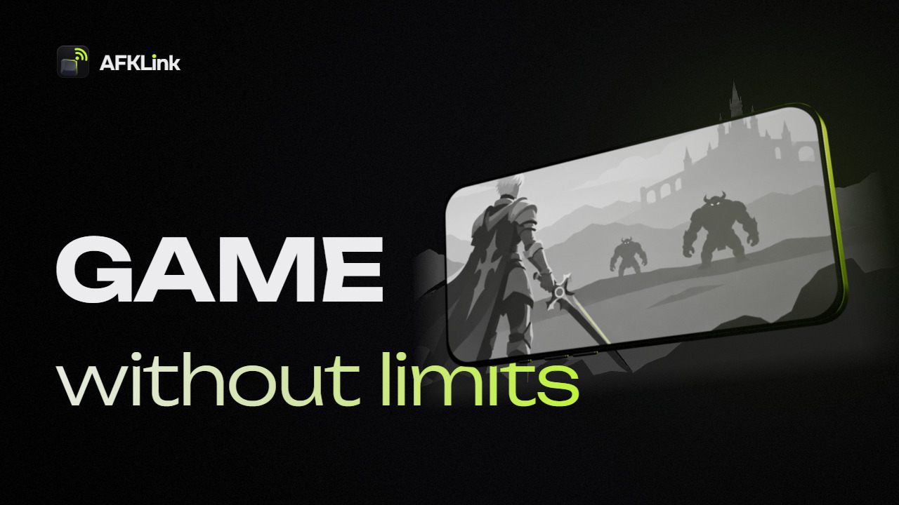
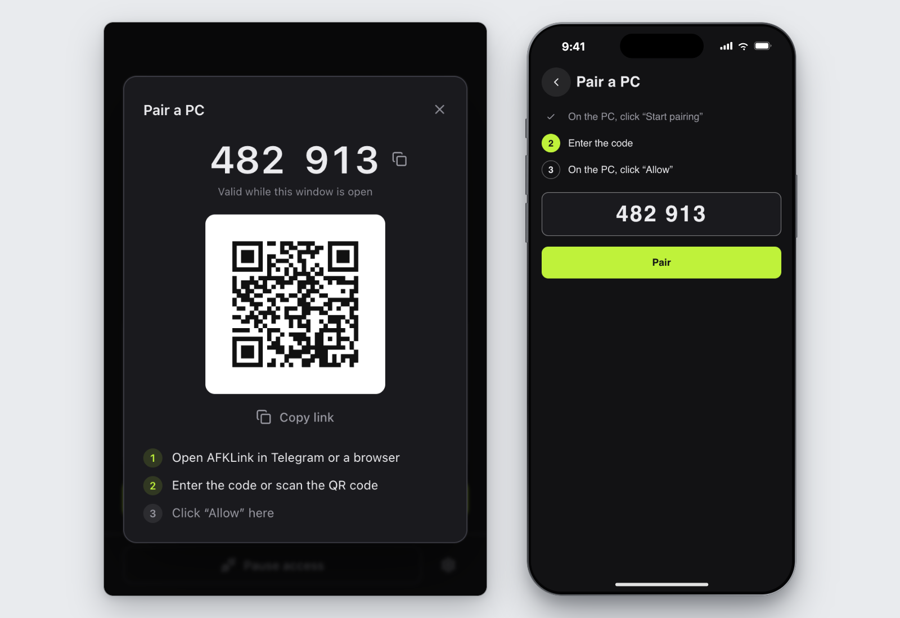

<p align="center">
  
</p>

<p align="center">
  <a href="https://github.com/afklink/afklink-pc/releases">Download</a> ·
  <a href="#get-started">Get started</a> ·
  <a href="#privacy">Privacy</a> ·
  <a href="#help">Help</a> ·
  <a href="README.md">Русский</a>
</p>

<p align="center">
  <a href="https://github.com/afklink/afklink-pc/actions/workflows/ci.yml"></a>
  <a href="LICENSE"></a>
</p>

**Your gaming PC, on your phone.** AFKLink opens the game running on your home PC in Telegram or a browser ([web.afklink.app](https://web.afklink.app)) on a phone, tablet or another
computer, with no app to install there. This repository is the Windows app that runs on the PC.

Early access: connecting needs an invite. Join the waitlist in
[@afklink_app](https://t.me/afklink_app) or ask a friend on AFKLink for a link.

## What it does

- **Encrypted stream.** H.264 over WebRTC, straight from your PC or, when there is no direct
  path, through the AFKLink TURN relay, which sees only encrypted packets.
- **Up to 1080p at 60 fps.** Quality follows your connection and your PC: 1080p60 on a good
  link, lighter on a weak one.
- **Easy on mobile data.** When you minimize AFKLink, no video is sent at all.
- **Input games actually read.** Mouse, keyboard and text in any language. If a game ignores
  standard Windows input, switch on the [virtual driver](#the-input-driver).
- **The game comes back.** If it crashes or gets minimized mid-session, AFKLink starts or restores
  it, with auto-launch on.
- **You decide who gets in.** Grant and revoke access from Telegram, see who's connected, and
  disconnect everyone with one click on the PC.
- **Friends see only the game.** In Game only mode a guest sees the game window; your desktop and
  other apps stay hidden.
- **Updates itself.** Installs only updates signed by AFKLink and rolls back one that fails.

## Requirements

- Windows 10 version 1903 or later, or Windows 11; 64-bit (x64).
- Microsoft Edge WebView2 Runtime. Windows 11 includes it; if it is missing, the app says so and
  offers to open the download page.
- The PC is on, online and running AFKLink.
- To watch and control: Telegram or a browser on a phone, tablet or another computer.

## Get started

Set AFKLink up at home, before you need it.

1. Download `AFKLink-<version>.exe` from [Releases](https://github.com/afklink/afklink-pc/releases)
   and run it on the PC. It is one exe with no installer.
2. In the app, click “Start pairing”.
3. Open AFKLink in Telegram or at [web.afklink.app](https://web.afklink.app) and enter the code
   or scan the QR code.
4. Click “Allow” in the app on the PC.



To keep the PC reachable after a restart, turn on “Start with Windows”. The app offers it once,
after the first pairing.

## Install and verify

A release has `AFKLink-<version>.exe`, its update signature, `SHA256SUMS`, an SBOM and the
licenses of the third-party code in the exe. To check that the exe was built by this
repository's release workflow:

```sh
gh attestation verify AFKLink-<version>.exe --repo afklink/afklink-pc
```

The app updates itself when no one is connected, installs an update only if it carries a valid
signature made with the AFKLink update key (minisign), and rolls back an update that fails. How
to check the checksums and the update signature by hand:
[RELEASING.md](RELEASING.md#verifying-a-download). How the app, the server and updates trust
each other: [SECURITY.md](SECURITY.md#trust-model).

## The input driver

Some games ignore input sent through Windows' `SendInput`. For them the app can install
[FakerInput](https://github.com/Ryochan7/FakerInput), a third-party virtual mouse and keyboard
driver by Travis Nickles (MIT). Its official installer, signed by its author, is embedded in the
app. It is installed only when you click “Install” under “Game controls” in the settings and
confirm the Windows prompt. You can remove it in the same place.

## Privacy

To run the service, the app sends the AFKLink server the PC's ID and public key, the app
version, a hash of hardware identifiers, the PC's name, pairing and connection setup data,
session statistics and app events. The statistics count input events by type, not which keys
you press. Logs go to the server when you click “Send logs”. After a crash, a hang, a long loss
of connection or a failed session, the app sends a short automatic report, unless the log level
is “Off”.

Video, input and, if the viewer turns on “Sync clipboard”, the clipboard go between the PC and
your device directly, or through the AFKLink TURN relay when there is no direct path. WebRTC
encrypts all of it. The AFKLink server decides who may connect, so it is part of the trust
boundary: see [SECURITY.md](SECURITY.md#trust-model). “History” (who connected and when) stays on
the PC; log files leave it only as described above.

Everything the app sends, item by item: [PRIVACY.en.md](PRIVACY.en.md).

## Help

- A question, or AFKLink won't connect: send `/help` to
  [@afklink_app](https://t.me/afklink_app) in Telegram and tap “Support”. During a session you can also tap the PC's name
  at the top and choose “Report issue”; on the PC, use “Settings” → “Diagnostics” → “Send logs”.
- A bug in the PC app or an idea for it:
  [open an issue](https://github.com/afklink/afklink-pc/issues/new/choose) with the Bug report
  or Feature request form.
- A vulnerability: report it privately, as described in [SECURITY.md](SECURITY.md), not in an
  issue.

## Build from source

You need Windows 10 1903+ or 11 (x64) and:

- [rustup](https://rustup.rs): it installs the compiler pinned in `rust-toolchain.toml` (1.98.1);
- [Bun](https://bun.sh) 1.4.2 (`packageManager` in `package.json`);
- Tauri CLI 2: `cargo install tauri-cli --version 2.12.1 --locked`;
- [NASM](https://www.nasm.us/) 2.10.06 or newer in `PATH`, optional. Without it OpenH264 is
  built without its assembly: the app works, but encodes slower.

From a git clone:

```sh
bun install --frozen-lockfile
bun run portable
```

This makes `dist\AFKLink-<version>-dev-<commit>.exe` for the AFKLink server, with a `.sha256`
file beside it.

Your build uses the same `%APPDATA%\AFKLink` folder as the official app: the same device and the
same pairings. It does not update itself. The AFKLink service accepts it like an official build.
The server sees each build's version, channel and commit: a build from source reports the `dev`
channel, and `bun run portable` adds its commit (a plain `cargo tauri build` has none).

<details>
<summary>Building for another server</summary>

To build for another server, set `AFKLINK_SERVER_URL` before the build. A plain
`cargo tauri build` in `app/src-tauri` without `AFKLINK_SERVER_URL` uses
`ws://localhost:8787/ws/agent`.

On first run the app saves the server address in `%APPDATA%\AFKLink\config.json`. On every start
it checks the saved address:

- `ws://localhost:8787/ws/agent` is replaced with the build's own address;
- a build for another server keeps any other address, so on a PC where AFKLink has already run,
  change `server_url` in that file;
- a build for the AFKLink server, such as `bun run portable`, replaces any other address that is
  not local with the AFKLink server's.

</details>

## Tests

```sh
cargo test --workspace --tests
bun run test:scripts
bun run typecheck
bun run lint --error-on-warnings
```

Tests that move the real cursor or type are marked `#[ignore]`; run them by hand on a machine
you are not using: `cargo test -p afklink-input -- --ignored`. The full set of checks is in
[CONTRIBUTING.md](CONTRIBUTING.md).

## Repository layout

| Path | What it does |
|---|---|
| `crates/core` | The agent: identity, config, signaling, sessions, quality control, logs |
| `crates/capture` | Screen capture with Windows.Graphics.Capture |
| `crates/encode` | H.264 encoding with OpenH264, built from source |
| `crates/transport` | WebRTC (str0m, patched copy in `vendor/str0m`) and the signaling socket |
| `crates/input` | Input: `SendInput`, or the FakerInput driver |
| `crates/clipboard` | Text clipboard sync |
| `crates/hw` | The hardware fingerprint |
| `crates/protocol`, `crates/i18n` | The wire protocol and Windows strings for the tray, notifications and dialogs, checked against `contract/` |
| `crates/game-helper` | Starts the chosen game and brings it back to the front during a session |
| `crates/agent` | `afklink-agent`, a headless CLI of the same pipeline |
| `crates/netem`, `crates/sim`, `crates/corpus` | Network model, offline session simulator and its screen corpus |
| `app/src-tauri`, `app/ui` | The desktop app (Tauri 2): window, tray, self-update, driver setup |

## Contributing

See [CONTRIBUTING.md](CONTRIBUTING.md). Every commit needs a `Signed-off-by` line
([Developer Certificate of Origin](https://developercertificate.org/)).

## License and trademarks

The code is licensed under [AGPL-3.0-only](LICENSE). The AFKLink name, logo and banner are not
covered by it: see [TRADEMARKS.md](TRADEMARKS.md).
