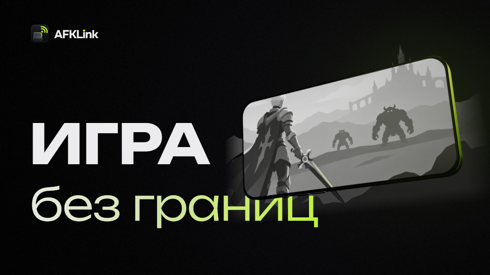
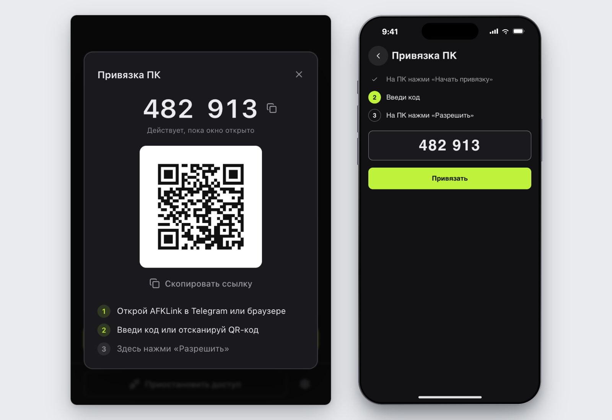

<p align="center">
  
</p>

<p align="center">
  <a href="https://github.com/afklink/afklink-pc/releases">Скачать</a> ·
  <a href="#как-начать">Как начать</a> ·
  <a href="#конфиденциальность">Конфиденциальность</a> ·
  <a href="#помощь">Помощь</a> ·
  <a href="README.en.md">English</a>
</p>

<p align="center">
  <a href="https://github.com/afklink/afklink-pc/actions/workflows/ci.yml"></a>
  <a href="LICENSE"></a>
</p>

**Твой игровой ПК — в телефоне.** AFKLink открывает игру с домашнего ПК в Telegram или
браузере ([web.afklink.app](https://web.afklink.app)) на телефоне, планшете или другом
компьютере, без отдельного приложения. Здесь — программа для Windows, которая работает на самом ПК.

Ранний доступ: подключаться можно по приглашению. Запишись в лист ожидания в
[@afklink_app](https://t.me/afklink_app) или попроси ссылку у друга в AFKLink.

## Что умеет

- **Зашифрованный поток.** Экран идёт по WebRTC (H.264) напрямую с ПК, а если прямого пути нет —
  через TURN-сервер AFKLink, который видит только зашифрованные пакеты.
- **До 1080p и 60 FPS.** Качество подстраивается под связь и мощность ПК: на хорошем канале
  1080p при 60 кадрах в секунду, на слабом картинка становится легче.
- **Бережёт мобильный трафик.** Свернёшь AFKLink — видео не идёт совсем.
- **Управление, которое видят игры.** Мышь, клавиатура и текст на любом языке. Если игра не
  реагирует на обычный ввод Windows, включи [виртуальный драйвер](#драйвер-для-игр).
- **Вылет — не проблема.** Если игра упала или свернулась посреди сеанса, AFKLink сам поднимет её,
  когда включён автозапуск.
- **Доступ решаешь ты.** Выдавай и забирай доступ в Telegram, смотри, кто подключён, и
  одной кнопкой на ПК отключай всех.
- **Другу — только игра.** В режиме «Только игра» гость видит окно игры, а рабочий стол и другие
  программы скрыты.
- **Обновляется сам.** Ставит только обновления с подписью AFKLink, неудачное откатывает.

## Что нужно

- Windows 10 версии 1903 или новее либо Windows 11, 64-разрядная (x64).
- Microsoft Edge WebView2 Runtime. В Windows 11 он уже есть; если его нет, приложение скажет об
  этом и предложит открыть страницу загрузки.
- ПК включён, подключён к интернету, и на нём запущен AFKLink.
- Чтобы смотреть и управлять: Telegram или браузер на телефоне, планшете или другом компьютере.

## Как начать

Настрой AFKLink дома, до того как он понадобится.

1. Скачай `AFKLink-<версия>.exe` в [Releases](https://github.com/afklink/afklink-pc/releases) и
   запусти его на ПК. Это один exe без установщика.
2. В приложении нажми «Начать привязку».
3. Открой AFKLink в Telegram или на [web.afklink.app](https://web.afklink.app), введи код или
   отсканируй QR-код.
4. На ПК нажми «Разрешить».



Чтобы ПК был на связи и после перезагрузки, включи «Запускать вместе с Windows». Приложение один
раз предложит это после первой привязки.

## Установка и проверка

В выпуске лежат `AFKLink-<версия>.exe`, его подпись обновления, `SHA256SUMS`, SBOM и лицензии
стороннего кода в exe. Проверить, что exe собран процессом выпуска этого репозитория:

```sh
gh attestation verify AFKLink-<версия>.exe --repo afklink/afklink-pc
```

Приложение обновляется само, когда никто не подключён, ставит обновление, только если оно
подписано ключом обновлений AFKLink (minisign) и подпись верна, а неудачное обновление
откатывает. Как вручную проверить контрольные суммы и подпись обновления:
[RELEASING.md](RELEASING.md#verifying-a-download). Как приложение, сервер и обновления доверяют
друг другу: [SECURITY.md](SECURITY.md#trust-model). Оба файла на английском.

## Драйвер для игр

Некоторые игры не принимают ввод через `SendInput` Windows. Для них приложение может поставить
[FakerInput](https://github.com/Ryochan7/FakerInput), сторонний виртуальный драйвер мыши и
клавиатуры (Travis Nickles, MIT). Официальный установщик драйвера, подписанный автором, вшит в
приложение. Он ставится, только если ты нажмёшь «Установить» в разделе «Управление в играх» в
настройках и подтвердишь запрос Windows. Там же драйвер можно удалить.

## Конфиденциальность

Для работы сервиса приложение отправляет на сервер AFKLink ID ПК и открытый ключ, версию
приложения, хэш идентификаторов оборудования, имя ПК, данные привязки и установки соединения,
статистику сеансов и события приложения. В статистике есть число событий ввода по типам, но не
сами клавиши. Логи уходят на сервер по кнопке «Отправить логи». После сбоя, зависания, долгой
потери связи или неудачного сеанса приложение само отправляет короткий автоотчёт, если в «Логи»
не выбрано «Выключены».

Видео, нажатия и буфер обмена, если зритель включил «Синхронизировать буфер обмена», идут между
ПК и твоим устройством напрямую, а если прямого пути нет, через TURN-сервер AFKLink. Всё это
шифрует WebRTC. Сервер AFKLink решает, кому можно подключиться, поэтому ему приходится доверять:
см. [SECURITY.md](SECURITY.md#trust-model). «Журнал» (кто и когда подключался) остаётся на ПК;
файлы логов уходят с него только так, как описано выше.

Полный список того, что уходит с ПК: [PRIVACY.md](PRIVACY.md).

## Помощь

- Вопрос или не получается подключиться: напиши `/help` в
  [@afklink_app](https://t.me/afklink_app) в Telegram и нажми «Поддержка». Во время сеанса можно ещё нажать на имя ПК вверху
  и выбрать «Есть проблема»; на самом ПК — «Настройки» → «Диагностика» → «Отправить логи».
- Ошибка в приложении для ПК или идея для него:
  [создай задачу](https://github.com/afklink/afklink-pc/issues/new/choose) по форме Bug report
  или Feature request.
- Уязвимость: сообщи приватно, как описано в [SECURITY.md](SECURITY.md), не в задаче.

## Сборка из исходников

Нужны Windows 10 1903+ или 11 (x64) и:

- [rustup](https://rustup.rs): он сам поставит компилятор из `rust-toolchain.toml` (1.98.1);
- [Bun](https://bun.sh) 1.4.2 (`packageManager` в `package.json`);
- Tauri CLI 2: `cargo install tauri-cli --version 2.12.1 --locked`;
- [NASM](https://www.nasm.us/) 2.10.06 или новее в `PATH`, по желанию. Без него OpenH264
  собирается без ассемблерных частей: приложение работает, но кодирует медленнее.

В клоне git:

```sh
bun install --frozen-lockfile
bun run portable
```

Получится сборка для сервера AFKLink: `dist\AFKLink-<версия>-dev-<коммит>.exe`, а рядом файл
`.sha256`.

Твоя сборка использует ту же папку `%APPDATA%\AFKLink`, что и официальная: то же устройство и те
же привязки. Сама она не обновляется. Сервис AFKLink пускает её так же, как официальную. Сервер
видит версию, канал и коммит каждой сборки: сборка из исходников сообщает канал `dev`, а
`bun run portable` добавляет коммит (у обычного `cargo tauri build` его нет).

<details>
<summary>Сборка для другого сервера</summary>

Чтобы собрать приложение для другого сервера, задай `AFKLINK_SERVER_URL` перед сборкой. Обычный
`cargo tauri build` в `app/src-tauri` без `AFKLINK_SERVER_URL` берёт
`ws://localhost:8787/ws/agent`.

При первом запуске приложение сохраняет адрес сервера в `%APPDATA%\AFKLink\config.json`, а при
каждом запуске сверяет сохранённый адрес:

- `ws://localhost:8787/ws/agent` сборка меняет на свой адрес;
- любой другой адрес сборка для другого сервера не трогает, поэтому на ПК, где AFKLink уже
  работал, поменяй `server_url` в этом файле;
- сборка для сервера AFKLink, например `bun run portable`, меняет любой другой нелокальный адрес
  на адрес сервера AFKLink.

</details>

## Тесты

```sh
cargo test --workspace --tests
bun run test:scripts
bun run typecheck
bun run lint --error-on-warnings
```

Тесты, которые двигают настоящий курсор и печатают текст, помечены `#[ignore]`; запускай их
вручную на машине, за которой сейчас не работаешь: `cargo test -p afklink-input -- --ignored`.
Полный набор проверок — в [CONTRIBUTING.md](CONTRIBUTING.md).

## Устройство репозитория

| Путь | Что делает |
|---|---|
| `crates/core` | Агент: устройство, настройки, сигналинг, сеансы, качество, логи |
| `crates/capture` | Захват экрана через Windows.Graphics.Capture |
| `crates/encode` | Кодирование H.264 в OpenH264, собранном из исходников |
| `crates/transport` | WebRTC (str0m, исправленная копия в `vendor/str0m`) и сокет сигналинга |
| `crates/input` | Ввод: `SendInput` или драйвер FakerInput |
| `crates/clipboard` | Синхронизация текста в буфере обмена |
| `crates/hw` | Отпечаток оборудования |
| `crates/protocol`, `crates/i18n` | Протокол и строки для трея, уведомлений и диалогов Windows; сверяются с `contract/` |
| `crates/game-helper` | Во время сеанса запускает выбранную игру и возвращает ей фокус |
| `crates/agent` | `afklink-agent`: тот же конвейер без окна, в командной строке |
| `crates/netem`, `crates/sim`, `crates/corpus` | Модель сети, симулятор сеанса и экранный корпус к нему |
| `app/src-tauri`, `app/ui` | Приложение (Tauri 2): окно, трей, обновление, установка драйвера |

## Участие

Смотри [CONTRIBUTING.md](CONTRIBUTING.md) (на английском). Каждый коммит — со строкой
`Signed-off-by` ([Developer Certificate of Origin](https://developercertificate.org/)).

## Лицензия и товарный знак

Код распространяется по [AGPL-3.0-only](LICENSE). Имя, логотип и баннер AFKLink лицензия
не покрывает: смотри [TRADEMARKS.md](TRADEMARKS.md).
